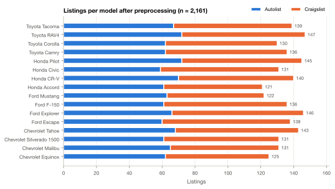
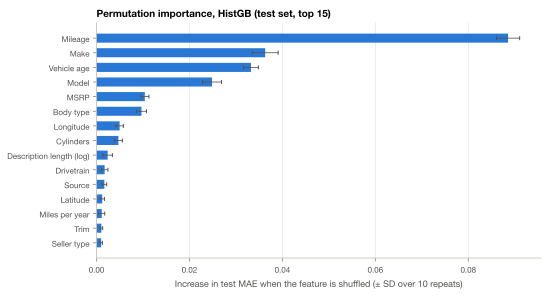

# Predicting Used-Car Value Retention from Multi-Source Listing Data

**Dustin Krol** · October 2026 · Repository: `ML-Project-One`

> **Summary.** We scraped 2,688 used-car listings for 16 models from four makes on Autolist and Craigslist. We added trim-level original MSRP from CarsDirect and built a cleaned, integrated dataset of 2,161 vehicles. The target is the **value retention ratio** (listing price ÷ original MSRP). A tuned histogram gradient-boosting model predicts it with a test MAE of **0.064** (about 6 percentage points of MSRP) and **R² = 0.84**. The mean baseline scores 0.186 and the make/model baseline 0.161. **Mileage is the strongest single driver** (about −2.3 pp of MSRP per 10,000 miles). Next is age at fixed mileage (about −1.4 pp per year), then the nameplate: at the same age and mileage, a Toyota Tacoma keeps 0.89 of MSRP and a Ford Escape 0.51. Condition phrases mined from listing text, such as "one owner" and "clean title", add almost nothing once age, mileage and seller type are known.

## 1. Project Description

A new car starts losing value as soon as it is sold, but not every car loses it at the same rate. This project builds an end-to-end pipeline that (1) collects used-car listings from several independent websites, (2) integrates them with each vehicle's original MSRP, (3) engineers features, including features from free-text descriptions, (4) trains and compares regression models that predict

<p class="equation">value retention ratio = current listing price / original MSRP</p>

and (5) uses the models to measure which factors drive depreciation.

**Scope.** Four mainstream makes, four high-volume models each, model years 2012–2024:

| Make | Models |
|------|--------|
| Toyota | Camry, Corolla, RAV4, Tacoma |
| Honda | Civic, Accord, CR-V, Pilot |
| Ford | F-150, Escape, Explorer, Mustang |
| Chevrolet | Silverado 1500, Equinox, Malibu, Tahoe |

The mix covers sedans, compact and mid-size SUVs, full-size pickups and a sports coupe, so body type and segment vary within each make. Every step is a Python module that runs from the command line (`python -m src.<step>`). Each step reads the previous step's files and writes its own, so the whole analysis can be rebuilt from the raw scraped files.

**Requirements met.**

| Requirement | Target | Achieved |
|---|---|---|
| Listing sources | ≥ 2 | 2 (Autolist, Craigslist) + 1 MSRP source (CarsDirect) |
| Listings per source before integration | ≥ 500 | 1,248 / 1,440 |
| Listings after preprocessing and deduplication | ≥ 1,000 | 2,161 |
| Makes / models per make | 3–5 / 3–5 | 4 / 4 |
| Original attributes in integrated data | ≥ 10 | 39 source attributes (44 columns in total) |
| Text-derived features | ≥ 2 | 8 regex flags + description length |
| High-cardinality encoding | ≥ 1 | Frequency, target (cross-fitted) and one-hot, compared |
| Regression algorithms | ≥ 3 | Ridge, Random Forest, HistGradientBoosting (+ 2 baselines) |
| Evaluation metrics | ≥ 2 | MAE, RMSE, R² (5-fold CV and held-out test) |

## 2. Data Collection

### 2.1 Sources

| Source | Role | Access method | Raw rows |
|---|---|---|---|
| **Autolist** | Dealer listings with structured vehicle-history fields | Public JSON search API, queried per model *and* per model year, plus a detail request per listing for its description | 1,248 |
| **Craigslist** | Private-party and dealer listings with free-text descriptions | Static search pages in 14 large US metros, then each posting page | 1,440 |
| **CarsDirect** | Original MSRP per make / model / year / trim style | JSON embedded in each model-year research page | 3,022 MSRP rows |

The two listing sources are deliberately different. Autolist is a dealer aggregator with clean structured fields: VIN, owner count, accident count, salvage flag and equipment. Craigslist is mostly free text, has both private sellers and dealers, and covers 14 metros (Los Angeles, SF Bay, San Diego, Seattle, Portland, Phoenix, Denver, Dallas, Houston, Chicago, Atlanta, Miami, New York, Boston). This difference makes integration harder, but it also lets us test whether a model trained on one market transfers to the other (Section 6.3).

**Sampling design.** Autolist was queried at six listings per model per model year. An unstratified search returns mostly late-model inventory, and that would have left too few older cars to measure age effects. Craigslist sampling was capped at 90 posting pages per model, spread across the metros. Both sources ended up exactly balanced by make: 312 Autolist and 360 Craigslist listings per make.

**Scraping practice.** Every scraper waits 1.5 s between requests to a host and caches each response on disk, so a parser fix never requires downloading the pages again. Each run is logged to `data/raw/collection_log.json`: 1,452 requests to Autolist (4 failures), 1,660 to Craigslist and 205 to CarsDirect. We checked `robots.txt` for each site and did not try to get around any bot protection.

### 2.2 Discussion: obstacles and choices

- **Most large listing sites block scripted access.** Cars.com, CarGurus, CarMax, TrueCar, Edmunds, Carvana, eBay Motors and Carfax returned HTTP 403/406. Autotrader served an Akamai block page, and Facebook Marketplace requires a login. Choosing the sources therefore came down mostly to which sites were reachable and allowed scraping.
- **MSRP was the hardest attribute to source.** KBB rejects non-browser clients, MotorTrend serves a bot challenge after a few requests, and Car and Driver has no pages for many older model years. CarsDirect had trim-level MSRP for all 16 models × 13 model years with no gaps. Autolist's own `msrp` field was not used because it is unreliable (sometimes it equals the listing price).
- **Inconsistent and missing fields.** 12.5% of Autolist rows had `price = 0` ("call for price"), because the API ignored the minimum-price filter. Craigslist prices and odometers are free-form strings (`$7,999.00`, `45k`), some prices are placeholders (`$1`), and many posts omit the odometer or title status. Dealers often repost the same car in several metros.
- **Trim granularity.** CarsDirect lists one MSRP per trim *style* (cab, bed and drivetrain variants), while listings usually name only a base trim (or no trim at all). This required a matching rule (Section 3.3).

## 3. Preprocessing and Integration

`python -m src.preprocess` merges the three raw files into `data/processed/integrated.csv`: 2,161 rows × 44 columns, one row per vehicle.

### 3.1 Schema mapping

The sources use different names, types and units for the same attribute, so each source column is mapped onto one shared schema. An abridged mapping:

| Integrated column | Autolist | Craigslist | Normalization |
|---|---|---|---|
| price | `price` | `price` (string) | Strip `$` and `,`; numeric USD |
| mileage | `mileage` | `miles` (string) | Strip `,` / `mi`; expand `45k`; both sources report miles |
| make / model | `make_name` / `model_name` | search key | Canonical names from the config |
| trim_raw | `trim` | `make_model` (free text) | Parsed for trim during MSRP matching |
| body_type, drivetrain, transmission, fuel_type | API enums | free-text attributes | Mapped to shared labels (`awd`/`4wd`/`4x4` → `awd_4wd`); unmapped → `other` |
| cylinders | `engine_cylinders` | `"6 cylinders"` | Integer |
| exterior_color | `normalized_color_exterior` | `paint` | Shared color names |
| title_status | `is_salvage` (bool) | `title_status` | `clean` / `salvage` / `rebuilt` / … |
| seller_type | — (always `dealer`) | `seller_type` | `dealer` / `owner` |
| condition | — (always "used") | `condition` | `unknown` for Autolist |
| city, state, zip, lat, lon | ✓ | ✓ | |
| owner_count, accident_count, equipment flags | ✓ | — | Kept, structurally missing for Craigslist |
| description | detail endpoint | posting body | Raw text for feature extraction |

### 3.2 Cleaning and deduplication

Each row is counted under the first rule it fails:

| Stage | Rows |
|---|---|
| Raw (Autolist 1,248 + Craigslist 1,440) | 2,688 |
| − EV / other-nameplate variants (Mach-E, F-150 Lightning, Equinox EV, Shelby GT350/500, …) | −32 |
| − price missing or < $1,000 (call-for-price, placeholders) | −238 |
| − price < $5,000 with "$X down" text (the listed price is a down payment) | −33 |
| − mileage missing, flagged broken, < 100 on a car ≥ 2 years old, or > 400k | −26 |
| − branded title (salvage, rebuilt, missing) | −154 |
| **After invalid / out-of-scope removal** | **2,205** |
| − duplicate VIN | −4 |
| − same year / make / model / exact mileage with price within 10% | −17 |
| **After deduplication** | **2,184** |
| − `value_retention_ratio` outside [0.10, 1.50] | −23 |
| **Final** (Autolist 1,031 / Craigslist 1,130) | **2,161** |

Branded-title cars were removed rather than kept as a feature: a salvage title cuts the price by a large and irregular amount that has little to do with normal depreciation, and there were too few of them to model. **Deduplication** sorts rows by source priority (Autolist first, for its richer fields) and completeness, then drops repeat VINs. Only 59% of Craigslist rows have a VIN, so a second rule drops rows with the same year, make, model and *exact* odometer reading whose prices are within 10%. An exact odometer reading within a model year is close to unique, and the 10% tolerance absorbs price changes between reposts.

### 3.3 MSRP matching

For each listing the pipeline (1) finds the longest CarsDirect trim name that appears as whole tokens in the listing's trim text, ignoring case and hyphens (`EX-L` = `EXL`). (2) If none matches, it tries aliases: engine labels stripped (`2.4 LX` → `LX`), `Base` dropped, and Chevrolet equipment groups collapsed (`1LT`/`2LT` → `LT`). (3) It then takes the **median MSRP across that trim's styles**. When no trim can be recognized it falls back to the median across all styles of that make/model/year. **Every row received an MSRP**: 98.2% of Autolist rows and 78.3% of Craigslist rows matched at trim level. Most Craigslist misses are posts that never name a trim.

### 3.4 Missing values

Price and mileage are required (the target and the main predictor). Categorical gaps become an explicit `unknown` level, so missingness can carry signal. Numeric gaps (cylinders, coordinates) are imputed *inside* the model pipeline, so test rows never contribute statistics. Autolist-only history fields stay missing for Craigslist and are **not** model inputs. Being missing for one whole source, they would act mostly as a proxy for the source. The text features (Section 4) are their cross-source substitute.

### 3.5 Exploratory statistics and discussion

| Attribute | Mean | Std | Min | Median | Max |
|---|---|---|---|---|---|
| Price (USD) | 17,260 | 9,298 | 2,250 | 15,500 | 62,490 |
| MSRP (USD) | 32,482 | 10,077 | 16,130 | 29,800 | 78,400 |
| Retention ratio | 0.54 | 0.23 | 0.10 | 0.53 | 1.31 |
| Model year | 2017.6 | 3.6 | 2012 | 2017 | 2024 |
| Mileage | 102,053 | 49,301 | 611 | 98,731 | 398,812 |

The two sources differ systematically (Figure 2). Craigslist cars have more miles (median 112k vs. 87k) and lower retention (median 0.45 vs. 0.60), and a third of Craigslist sellers are private owners. `source` and `seller_type` are therefore model features, and we also evaluate across sources. A sanity check shows the expected ordering: median retention is 0.38 for model years 2012–14, 0.44 for 2015–17, 0.56 for 2018–20 and 0.73 for 2021–24. 56 listings (2.6%) have a ratio above 1.0. Most are 2021–24 model years, and 39 of the 56 are Toyotas (20 are Tacomas), consistent with the post-2021 used-car price spike, when sought-after nearly new models sold above sticker. A few probably also reflect an under-matched MSRP: a well-equipped trim that fell back to the median of its styles. They were kept, because they fall inside the plausible [0.10, 1.50] range.

## 4. Feature Engineering

`python -m src.features` writes 33 model inputs per listing to `data/processed/features.csv`.

### 4.1 Structured features

| Feature | Definition | Rationale |
|---|---|---|
| `vehicle_age` | Listing year − model year (0–14) | Core depreciation driver |
| `miles_per_year` | mileage / max(age, 1) | Usage intensity, separate from total wear |
| `region` | US Census region from `state` | Regional demand |
| `trim_key` | `make model trim` (178 levels) | Equipment level within a model |
| `city_key` | `city, state` (880 levels, 613 seen once) | Local market |
| `has_description`, `log_description_len` | Description present; log(1 + characters) | Listing effort / seller type |

### 4.2 Features from listing descriptions

Eight regex extractors run over the lowercased title and description. Phrases that can be negated ("not one owner", "no engine issues") are discarded when a negation word appears in the 15 characters before the match.

| Feature | Flagged | Autolist | Craigslist | Why it should matter |
|---|---|---|---|---|
| `txt_one_owner` | 15.4% | 14.7% | 16.0% | Known history, consistent care |
| `txt_clean_title` | 19.9% | 2.6% | 35.7% | Seller reassurance (branded titles were already removed) |
| `txt_clean_history` | 10.7% | 13.2% | 8.5% | Clean Carfax / AutoCheck |
| `txt_accident_free` | 7.5% | 5.4% | 9.3% | Accident history lowers resale value |
| `txt_service_records` | 4.3% | 3.3% | 5.2% | Documented maintenance |
| `txt_new_tires` | 5.3% | 2.1% | 8.2% | Recent spending the buyer avoids |
| `txt_non_smoker` | 4.6% | 3.3% | 5.8% | Interior condition |
| `txt_needs_work` | 0.4% | 0.4% | 0.4% | Known mechanical problems |

**Validation.** Autolist's structured history fields serve as labels for two extractors. `txt_one_owner` has **0.89 precision** against `owner_count == 1`, and `txt_accident_free` has **0.95 precision** against `accident_count == 0`. Recall is low (0.34 and 0.08) because most dealer descriptions don't restate the history report. For a flag feature, precision matters more. Two rounds of spot checks added missed phrasings ("clean texas title", "1 previous owner", run-together text) and removed noisy candidates: "certified pre-owned" and "warranty" mostly appear in dealer SEO boilerplate.

### 4.3 Encoding high-cardinality features

`trim_key` (178 levels), `state` (50) and `city_key` (880) are too sparse for plain one-hot encoding. Three encodings are implemented in one `ColumnTransformer`, which is fit only on training rows inside each model pipeline:

- **Frequency encoding** (custom `FrequencyEncoder`): replaces a level with its share of training rows. It never sees the target, so it cannot leak it. Unseen levels map to 0.
- **Target encoding** (scikit-learn `TargetEncoder`): replaces a level with a smoothed mean of the target. It is **cross-fitted**, so each training row is encoded from the other folds and never from its own price. Smoothing shrinks the 613 single-listing cities toward the global mean.
- **One-hot** (levels with < 5 rows grouped as "infrequent"): the baseline, with 297 columns vs. 95.

| Encoding (5-fold CV) | Ridge MAE | Ridge R² | HistGB MAE | HistGB R² |
|---|---|---|---|---|
| One-hot | 0.0687 | 0.844 | 0.0661 | 0.853 |
| Frequency | 0.0702 | 0.835 | 0.0664 | 0.853 |
| Target | 0.0695 | 0.840 | 0.0676 | 0.847 |

**Discussion.** The encodings are within one CV standard deviation of each other (0.002–0.004). These columns add little beyond `msrp` and `model`: the trim's information is mostly already in its MSRP, and a city seen once has no reliable target mean. We kept frequency encoding as the default, because it ties the best boosted score without using the target or adding 200 columns, and we made the encoding a tuned hyperparameter in Section 5. **Leakage controls:** `price` and the target are rejected as features by an explicit check. Imputation, scaling and every encoder are fit inside the CV folds. The text flags are binary, so dollar amounts written in descriptions never reach the model.

## 5. Model Development

### 5.1 Validation strategy

The data are split once into 1,728 training and 433 test rows (80/20, stratified by make, seed 42). All tuning and model selection uses **5-fold cross-validation on the training split**. Each candidate is a single `Pipeline(preprocessor, model)`, so every fold refits its own imputers, scalers and encoders. The test set is scored once, by the final refit models. Every random step uses seed 42, and three back-to-back runs gave identical results.

### 5.2 Algorithms

| Model | Why it was chosen | Search | Selected hyperparameters |
|---|---|---|---|
| Mean baseline | Floor: always predicts the training mean | — | — |
| Make/model mean | What the nameplate alone explains | — | — |
| **Ridge regression** | Linear and interpretable. L2 handles ~300 one-hot columns and the correlated age / mileage / MSRP | Grid: α ∈ 10⁻²…10³ (11) × 3 encodings | one-hot, α = 1 |
| **Random Forest** | Bagged deep trees capture interactions with little tuning | Random search, 20 of 144 | one-hot, `max_features` = 0.33, `min_samples_leaf` = 1, unlimited depth, 300 trees |
| **HistGradientBoosting** | Boosted shallow trees, usually the strongest on tabular data | Random search, 30 of 729 | frequency, learning rate 0.05, 800 iterations, 7 leaves, `min_samples_leaf` = 20, L2 = 0.1 |

Models were selected on CV MAE. MAE is in the same units as the target (a fraction of MSRP) and is less dominated by a few extreme listings than RMSE.

## 6. Evaluation Results

### 6.1 Overall performance

| Model | CV MAE | CV RMSE | CV R² | Train MAE | Test MAE | Test RMSE | Test R² |
|---|---|---|---|---|---|---|---|
| Mean baseline | 0.1929 ± 0.0034 | 0.2318 ± 0.0019 | −0.001 | 0.1928 | 0.1861 | 0.2245 | 0.000 |
| Make/model mean | 0.1608 ± 0.0058 | 0.1960 ± 0.0065 | 0.284 ± 0.040 | 0.1592 | 0.1610 | 0.1942 | 0.252 |
| Ridge | 0.0687 ± 0.0005 | 0.0915 ± 0.0032 | 0.844 ± 0.009 | 0.0574 | 0.0671 | 0.0953 | 0.820 |
| Random Forest | 0.0725 ± 0.0036 | 0.0962 ± 0.0053 | 0.827 ± 0.017 | 0.0260 | 0.0693 | 0.0978 | 0.810 |
| **HistGradientBoosting** | **0.0630 ± 0.0024** | **0.0853 ± 0.0035** | **0.864 ± 0.010** | 0.0365 | **0.0635** | **0.0906** | **0.837** |

- **HistGradientBoosting is the best model on every metric** (Figure 13). A test MAE of 0.064 means a typical prediction is off by about 6 points of MSRP, roughly $1,600 on a $25k car. It beats Ridge by 0.006 CV MAE, about 2.5 CV standard deviations.
- **All tuned models beat both baselines by a wide margin.** The nameplate alone cuts the mean predictor's error by 17%, and the full feature set cuts it by a further 60%.
- **Ridge comes a close second**, so most of the signal is roughly additive in the standardized features. Boosting gains on non-linearities, such as the flat-then-steep age curve, and on interactions.
- **Test vs. CV.** Test MAE is within 0.0035 of CV MAE for every tuned model, and the ranking is the same, so the CV estimates are reliable. Test R² is slightly lower only because the test target has a little less variance.

### 6.2 Over- and underfitting

The Random Forest fits its training data almost perfectly (train MAE 0.026 vs. CV 0.073). Every constrained setting scored *worse* in CV, so the forest is limited by variance: ~1.7k rows are not enough for deep bagged trees over ~300 columns. Boosting's shallow 7-leaf trees keep the gap moderate (0.037 vs. 0.063). Ridge has the smallest gap (0.057 vs. 0.069) and underfits slightly.

### 6.3 Cross-source generalization (test MAE, HistGB)

| Trained on → tested on | Autolist | Craigslist |
|---|---|---|
| Autolist only | 0.053 | 0.083 |
| Craigslist only | 0.078 | 0.075 |
| Both (pooled model) | 0.052 | 0.073 |

Dealer listings are easier to predict than Craigslist listings. Private-party prices are negotiable and noisier, and the data are less structured. A model trained only on Autolist works almost as well on Craigslist as one trained on Craigslist itself. Pooling both sources is best for both test sets, so the noisier Craigslist rows do not hurt the dealer predictions. Ridge transfers worst: trained on Craigslist, it reaches 0.107 MAE on Autolist.

### 6.4 Residual patterns

Errors are largest for the **Tacoma** (MAE 0.117), whose retention (mean 0.79) is far above every other model's, so the shared age and mileage effects fit it worst. They are also largest for the **newest and least-driven cars** (age 0–2: 0.087; < 30k miles: 0.093), where retention is highest and data are scarcest. Mean residuals stay within ±0.022 for every vehicle model, so no model is systematically mispriced (Figure 15). The single worst test error is instructive: a 2024 Tacoma with 26k miles listed by its owner for $5,500 ("car won't start, moving out of state, need gone ASAP"). The model predicted 0.88 of MSRP, and the actual ratio was 0.14. The `txt_needs_work` flag fires on only 0.4% of listings, too few for the trees to learn from.

## 7. Depreciation Analysis and Feature Ranking

`python -m src.depreciation` reloads the three fitted pipelines and analyzes them on the same split. All effects are in **percentage points (pp) of MSRP**.

### 7.1 Age and mileage

Average change in predicted retention when each test car is made older or more driven. `miles_per_year` is recomputed, so each counterfactual car is internally consistent:

| Scenario | Ridge | Random Forest | HistGB |
|---|---|---|---|
| +1 year, same mileage | −2.0 | −0.9 | −1.4 |
| +10k miles, same age | −2.3 | −2.3 | −2.3 |
| +1 year **and** +12.1k miles (median annual use) | −4.8 | −3.6 | −4.3 |

- **A typical year of ownership costs about 4–5 pp of MSRP** (−4.3 pp for the best model, roughly $1,100 on a $25k car). **About two thirds of that comes from the miles driven, one third from age itself.**
- **Mileage is the strongest single driver.** All three models agree on −2.3 pp per 10k miles. Partial dependence (Figure 12) falls from 0.79 at 0 miles to 0.48 at 120k and 0.33 at 200k, with the steepest slope between 40k and 160k.
- **Age matters less once mileage is held fixed.** Raw mean retention falls 3.6 pp per year (0.81 at age 2 to 0.38 at age 14; Figure 4), but most of that fall comes with the added miles. Holding each car's mileage fixed, the boosted model's curve is nearly flat for ages 2–5 and falls more steeply after year 5 (−1.4 pp/year on average).
- **Age and mileage are hard to separate** (r = 0.54). Dropping either one alone barely changes CV MAE, because each stands in for the other. Dropping both, with miles/year, raises CV MAE from 0.063 to 0.119, almost back to the make/model baseline.

### 7.2 Feature ranking and method agreement

Features were ranked by five methods: Ridge contribution spread, Random Forest impurity, and test-set permutation importance for each of the three models. Correlated sets were also permuted together (Figures 8–10).

| Rank | Feature | Evidence |
|---|---|---|
| 1 | Mileage | #1 under all five methods |
| 2 | Vehicle age | #2–3 everywhere |
| 3 | Make | #2 for both tree-model permutations |
| 4 | Model | #3–5 |
| 5 | MSRP | Ridge: −0.44 pp per $1k. Pricier trims lose a larger share of MSRP |
| 6 | Description length | Mostly marks the source (only Autolist lacks descriptions) |
| 7 | Trim | High for Ridge (one-hot), low for the trees |
| 8 | Body type | #4–6 for the trees: trucks depreciate differently with mileage |

Shuffled together, **age + mileage + miles/year** raise test MAE by about 0.12 in every model, and **make + model + trim + MSRP** by 0.07–0.10. Every other group adds less than 0.017. **The methods agree on the top four features** but disagree further down: Spearman correlations are 0.85–0.95 within a model family and 0.53–0.71 between families. Each disagreement has a clear cause:

- *Nested categories.* Trim implies model and model implies make, so models can put the same information in any of them. Ridge spreads it across one-hot model and trim columns, while the trees split on make first.
- *Impurity inflates continuous features.* Miles/year is #5 by RF impurity but #8–19 by permutation. Impurity rewards features with many candidate splits even when the splits fit noise.
- *Linear vs. non-linear.* Body type and cylinders rank high for the trees, which use them in interactions, and low for Ridge, which can only fit them additively.

### 7.3 Brand and model

Comparing raw means would be confounded, because the models differ in average age and mileage. Instead, each model gets its own fit `ratio ~ age + mileage`, and the models are compared at the same reference car: 5 years old, 60k miles (Figure 6).

| Holds value best | Retention | Holds value worst | Retention |
|---|---|---|---|
| Toyota Tacoma | 0.89 | Ford Escape | 0.51 |
| Toyota RAV4 | 0.83 | Ford Explorer | 0.53 |
| Honda Civic | 0.83 | Chevrolet Malibu | 0.55 |
| Toyota Corolla | 0.83 | Chevrolet Equinox | 0.57 |

By make, the reference-car retention is Toyota 0.83, Honda 0.75, Ford 0.62 and Chevrolet 0.60. **The makes differ mainly in level, not in rate.** Per-make slopes are similar (−1.5 to −2.0 pp/year and −2.4 to −2.7 pp per 10k miles). A Toyota's advantage appears early and persists, rather than growing with age. The Tacoma's fitted age slope is about zero: it loses value only with mileage.

### 7.4 Condition indicators and text features

The structured condition field and the text flags behave very differently. Craigslist's seller-reported condition carries real signal: Ridge gives "fair" −12.7 pp and "excellent" +5.8 pp relative to the other levels (Figure 11). **The text flags did not help prediction.** Shuffling all eight together raises test MAE by only 0.0006–0.0011, and dropping them slightly *improves* boosted CV MAE (0.0630 → 0.0623, within noise). The reasons:

- **Confounding.** "Clean title" has a raw median gap of −18 pp, and Ridge still estimates −2.7 pp after controls. A clean title doesn't lower the price. The phrase marks *private-sale older cars*: 56% of private listings say it vs. 13% of dealer listings, and flagged cars are older (9.7 vs. 8.0 years) with more miles (124k vs. 96k). Age, mileage and seller type already describe these cars.
- **Sparsity.** `needs_work` has the largest controlled effect (−10.3 pp), but it fires on just 9 listings.

**Caveats.** All effects are associations in *asking prices*, not causal effects on transaction prices. Single-feature importances understate correlated groups, so the grouped and ablation numbers are the reliable ones for age/mileage and for nameplate. Effects at the extremes (under 2 years, under 30k miles) rest on few listings.

## 8. Visualizations

All figures are generated by `python -m src.plots` from the saved tables and written to `reports/figures/` as PNG and SVG. They share one style: a colorblind-safe categorical palette assigned in a fixed order (each make keeps its color in every figure), a single blue for one-series charts, a red–gray–blue diverging scale for signed values, hairline gridlines and labeled units.

### 8.1 Data characteristics





### 8.2 Feature ranking




### 8.3 Model performance


## 9. Discussion and Conclusion

### 9.1 Most important factors affecting vehicle value

Four factors explain most of a used car's value relative to its MSRP: **mileage, age, make and model**, in that order. They are the top four under every ranking method. Together, the usage group (age, mileage) and the nameplate group (make, model, trim, MSRP) take the model from R² = 0 to R² = 0.84. Everything else adds less than 0.02 MAE even when shuffled as a group: body style, drivetrain, location, source, seller type and the text flags.

### 9.2 Major drivers of depreciation

- **Usage is the main driver, and mileage is its larger part.** A typical year costs about 4.3 pp of MSRP, two thirds from miles and one third from age. Mileage costs a steady −2.3 pp per 10k miles. Age at fixed mileage costs little for the first five years and more after that.
- **The brand sets the level.** At the same age and mileage, the best model (Tacoma, 0.89) keeps 38 pp more of its MSRP than the worst (Escape, 0.51). Brands depreciate at similar rates, so Toyota and Honda's advantage is a level shift that is visible from year 2.
- **Condition matters where it is measured.** Seller-stated condition shifts retention by 6–13 pp. Free-text proxies for condition and history are mostly confounded with age and seller type, or too rare to learn from.

### 9.3 Challenges in data collection and integration

- **Access.** Ten of the twelve listing sites we evaluated, and three of the four MSRP sources, block scripted access or require a login. Choosing sources became a question of which sites were reachable and allowed scraping, not which had the most useful data.
- **Schema mismatch.** One source has structured history fields and the other has free text. Prices and odometers arrived as strings, the category vocabularies differed, and several attributes exist in only one source. Integration needed an explicit mapping and unit normalization, and some fields had to be left out of the model because they existed in only one source.
- **Dirty prices.** About 10% of raw rows had placeholder, call-for-price or down-payment prices. These had to be identified by rule, not just dropped as outliers: a "$3,000" price on a late-model truck is usually a down payment, not a bargain.
- **Duplicates without keys.** 41% of Craigslist posts lack a VIN, and dealers repost across metros, so deduplication relies on a fuzzy year/model/exact-odometer/price rule.
- **MSRP matching.** Listings rarely name the exact trim style CarsDirect prices, and 22% of Craigslist posts name no trim at all. The median-of-styles fallback guarantees a match but adds noise to the denominator of the target.

### 9.4 Limitations

- **Asking price ≠ sale price.** Every target value is an asking price. Negotiation discounts, especially for private sellers, are invisible.
- **A single snapshot.** All data were scraped on one day in October 2026, in a used-car market still affected by the post-2021 price spike. Depreciation rates estimated from one snapshot mix true depreciation with differences between model years.
- **Geographic and seller bias.** Craigslist covers 14 large metros, and Autolist covers dealers only. Rural markets and private sellers outside Craigslist are not represented.
- **MSRP noise.** Median-of-styles matching hides cab and bed differences on trucks, and hybrids get the gas trim's MSRP (CarsDirect lists no hybrid trims for four models), so their retention is overstated.
- **Narrow scope.** Four mainstream, mostly reliable brands and 16 models. The findings may not carry over to luxury makes, EVs (which were excluded) or cars older than 14 years.
- **Moderate sample size.** 2,161 rows limit the forest (it overfits) and make estimates for rare levels unreliable (cities, trims, `needs_work`).
- **Associations, not causes.** The importance and coefficient results describe asking-price patterns, not what would happen if one attribute of a car changed.

### 9.5 Conclusion

**Findings.** Value retention can be predicted to within about 6 pp of MSRP from a few listing attributes. Usage (especially mileage) and nameplate account for almost all of the explainable variation. Gradient boosting beats a well-regularized linear model, but only modestly, so depreciation is close to additive in these features. The Toyota/Honda vs. Ford/Chevrolet gap is a stable level difference, not a faster rate of loss.

**What we learned.**

- **Data work dominated the effort.** Most of the effort and most of the judgment calls went into source selection, cleaning and MSRP matching, not modeling. The model ranking barely changed with tuning, while the dataset's quality decided what could be learned.
- **Leakage-safe pipelines are worth building early.** Fitting every encoder inside the CV folds made the encoding choice a fair hyperparameter, and the CV estimates matched the test set within 0.004.
- **Feature importance needs more than one method.** Single-feature rankings disagreed for clear reasons (correlation, nesting, impurity bias). Grouped permutation and ablation gave consistent answers.
- **A raw association is not an effect.** The "clean title" flag looked like an 18-point effect until it was conditioned on seller type and age.

**What we would do differently or next.**

1. **Collect over time.** Scrape repeatedly over several months, and where possible use sold prices, to separate depreciation from model-year effects and asking-price noise.
2. **Broaden the scope.** Add more sources and cover luxury makes and EVs, where depreciation is known to behave differently.
3. **Improve MSRP matching.** Decode VINs to resolve the exact trim and style, including hybrids.
4. **Model the Tacoma-like cases explicitly.** Try per-segment models or quantile regression to give prediction intervals, which matter most where errors are largest.
5. **Explain individual predictions.** Add SHAP values for per-listing explanations of the boosted model.

## 10. AI Usage Statement

> **[Author to complete before submission. This statement must accurately describe your own process. The draft below lists only what the repository itself shows; replace or confirm each bracketed item.]**

**Tools used.**

- **Claude Code** (Anthropic; Claude models, run in the VS Code extension). It was used as a coding assistant throughout the project, and the repository's Claude Code permission settings record that it ran the scrapers and pipeline steps. Specifically: implementing the scrapers, the preprocessing / MSRP-matching pipeline, the feature-engineering and text-extraction code, model training and tuning, the depreciation analysis and the plotting module. It also drafted the per-ticket implementation notes, generated the figures, and drafted this report from the pipeline outputs.
- [Any other AI tools used, e.g. for research or writing, and what for.]

**Completed independently by the author.** [For example: the project scope and choice of makes/models; the per-step implementation plan (tickets); choosing and evaluating data sources; reviewing and validating scraped data and text-feature spot checks; decisions on cleaning rules and MSRP matching; reviewing all code and results; interpreting findings; final editing of this report. Edit this list so it reflects what you did.]

**Verification.** [Describe how you checked AI-generated code and text, e.g. re-running each pipeline step, spot-checking outputs against the source websites, and reviewing every number in this report against the generated tables.]

## Appendix: Reproducing the results

```
python3 -m venv .venv && source .venv/bin/activate
pip install -r requirements.txt
python -m src.scrapers.autolist          # optional: re-scrape (results cached in data/cache/)
python -m src.scrapers.craigslist
python -m src.scrapers.carsdirect_msrp
python -m src.preprocess                 # -> data/processed/integrated.csv, reports/eda_summary.md
python -m src.features                   # -> data/processed/features.csv, reports/text_features.md
python -m src.train                      # -> reports/model_results.*, models/*.joblib
python -m src.depreciation               # -> reports/depreciation_analysis.md, feature_importance.csv
python -m src.plots                      # -> reports/figures/*.png, *.svg
python -m src.report                     # -> reports/final_report.pdf (needs Chrome or Chromium)
```

The committed raw files in `data/raw/` reproduce every downstream number without scraping again. Re-scraping fetches the current listings, so the counts and results will differ.
